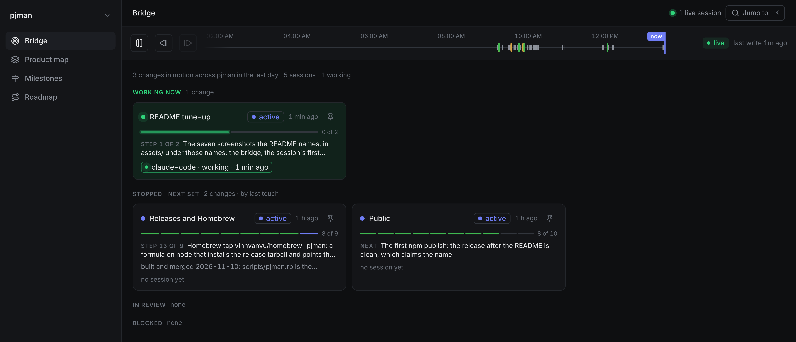
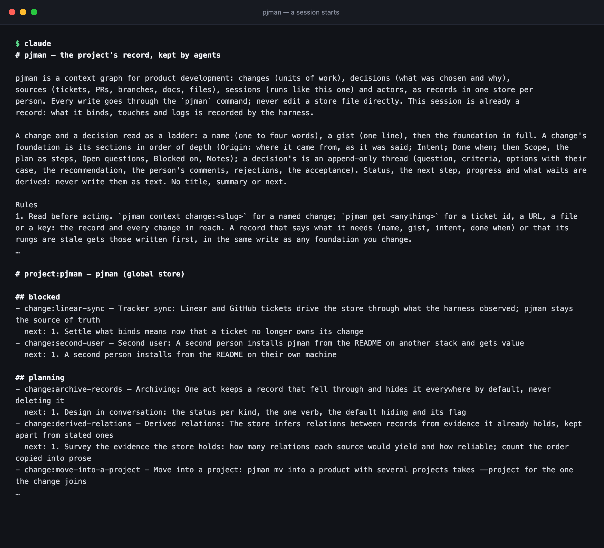
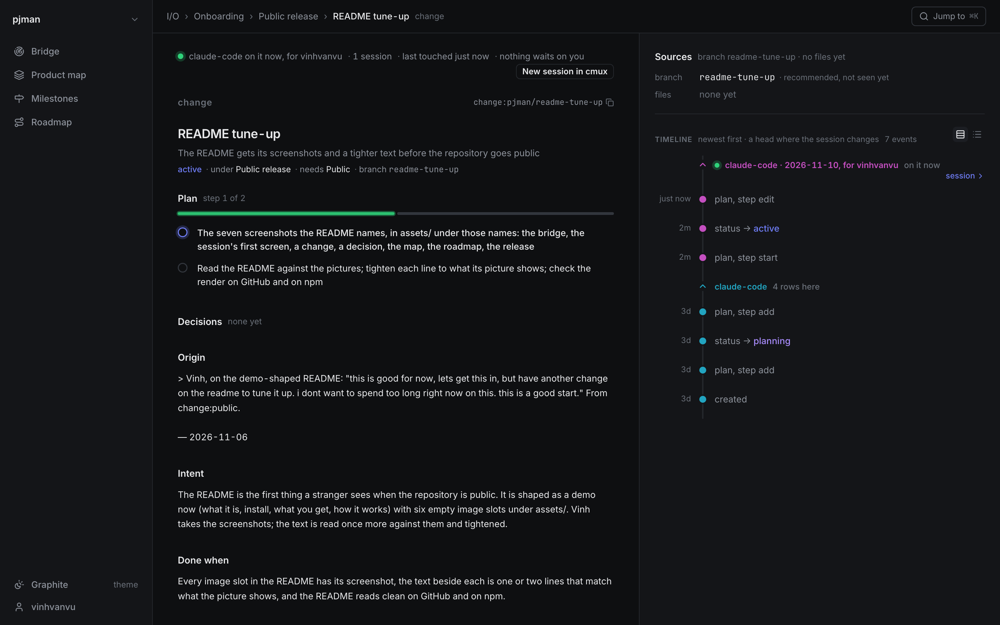
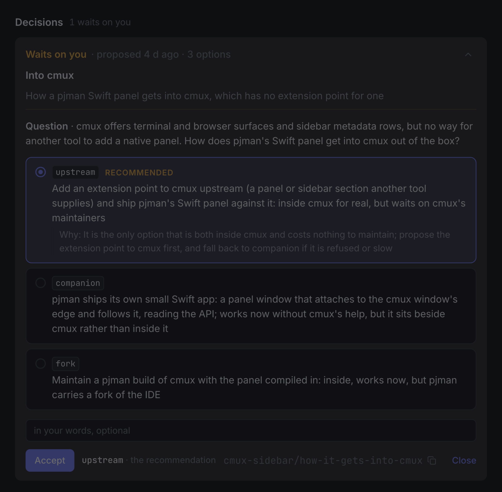

# pjman

**Every change, every decision, and why.**

pjman is an opinionated framework for product development and project management, built on a context graph your agents keep and you steer.



Coding agents are good at doing the work and bad at remembering why. Each session starts from nothing, a choice made last week lives in a chat that is gone, and a plan sits in a reply nobody can find. pjman gives the work a fixed shape: what the product is, each unit of work with where it came from and what done means, every choice with its options and who accepted it, and the sessions that did it. The agents read that shape at the start of every session and write to it through one command. You read it, steer it and make the decisions.

The structure is the product. The store under it is a git repository of Markdown files on your machine.

## The opinion

pjman holds a view of how product work should be recorded. It is enforced by the command where it can be, and taught to the agent where it cannot.

### The product map

What the product is lives in a tree beside the work: a **product** at the root, **features** beneath it (what the product does for a person, in a sentence a user would recognise), and **capabilities** beneath those (a distinct behaviour a change can add, change or remove). The levels are defined by who asks about them, never by size. A change names the node it adds, changes or removes, and a node's state follows from those changes: live once an adding change is done, retired once a removing one is. Nobody writes a feature's status by hand.

### Changes

A **change** is a unit of work, read as a ladder: a name (one to four words), a gist (one line), then its foundation written in full:

- **Origin**: where the work came from, as it was said. The person's words quoted, or the key of the ticket, change or decision it came from.
- **Intent**: the need, and for whom.
- **Done when**: the outcome that closes it.
- **Plan**: steps stored as data (open, active, done, dropped, each with a note), written only through `pjman step`.

Then, as the work reaches them, Scope, Open questions, Blocked on and Notes. Status, progress and the next step are derived from the plan and never written as text. A milestone is a change whose plan is the changes filed under it.

### Decisions

A **decision** is an append-only thread on a change: the question, the criteria, the options each with its case, one recommended with the reason, the person's comments in their own words, any rejections, then the acceptance. Before a choice that forecloses options, the agent opens one as `proposed` and goes on around it. Only a person accepts it: the command refuses an acceptance not attributed to a `person:` actor, and the skill tells the agent never to accept one. A decision accepted on the dashboard wakes the session waiting on it.

### Aspects

Some rules hold across the product rather than at one place on the map: how text reads, how the app moves, a component many views draw. An **aspect** keeps such a rule as a base, with a **place** for each part of the map it applies to, where a fork records only what differs there. A change that touches a place is worked under its aspect.

### Sessions

Every agent run is a **session** record, and it binds to the change it is working: from the branch it starts on, from a change the prompt names, or from a change it files. What it reads, writes and logs lands on that change, so whoever picks the work up next, you or another session, starts from the record and not from a handoff note.

## The method without the tool

The structure works on paper. If you want the opinion without pjman, keep these rules by hand:

1. **Name what the product is before naming the work.** Keep a short tree: the product, what it does for a person, the distinct behaviours under each. Every piece of work points at one node.
2. **Write the origin as it was said.** Quote the request or link where it came from. Do not paraphrase it into a task.
3. **Say what done means before starting.** One outcome that closes the work, written down with the intent.
4. **Keep the plan as steps, and keep them true.** Before stopping, leave the step in progress noted and the next one first. Never write a status or a "next" by hand when the steps already say it.
5. **Open a decision before a choice that closes doors.** Lay out the options with their costs, recommend one, and let a person accept it in their own words. An agent proposes; it never accepts.
6. **Never rewrite a decision.** Add to its thread: a new option, a comment, a rejection, a reversal. The history is the point.
7. **Write a rule that holds everywhere once.** Keep the base in one place and record only how each place differs from it.

## Who it is for

One person working with coding agents on real products, who wants the work to survive between sessions and the choices to stay theirs. It is built for its author's own daily work, both at a job and in building pjman itself, and is used that way every day. It is opened up for anyone who works the same way. It runs locally, with no account and no server beyond the dashboard on your machine.

## Install

Node 24 or newer, and git.

```bash
npm install -g @vinhvanvu/pjman   # or: brew install vinhvanvu/pjman/pjman
```

Homebrew brings its own Node. Trusting the tap, an npm copy that shadows the Homebrew one, and upgrading: [docs/install.md](docs/install.md).

Then run `pjman init` in a repository. It asks one question, whether the first session should propose a product map from the repository, and prints what it did:

```console
$ cd acme && pjman init
Should the first session propose a product map from this repository? [Y/n]
created the global store at ~/.pjman/store (its own git repository)
created person:ada
the repository holds code (package.json)
created product:acme
registered project:acme under product:acme
the first change through intake proposes a product map …
…
you are person:ada
Claude Code: installed the pjman plugin at user scope (hooks, skill, brief, Linear MCP); it loads at the next session or /reload-plugins
dashboard: http://127.0.0.1:7331
left to do: nothing here; to read tickets, sign in to the tracker from inside a session (/mcp)
```

You now have a store of your own at `~/.pjman/store`, the repository registered as a project under a product, the Claude Code plugin installed when `claude` is on the PATH, and the dashboard running. Running `pjman init` again is the health check: it repairs what is missing and undoes nothing. `pjman doctor` names what is wrong with an install and the command that fixes each thing.

## With Claude Code

Run `claude` in the repository. The plugin opens every session with what pjman is, the rules the agent works by, and what is in flight:



Then say what you want done:

```text
you    export a saved card as a PDF
agent  filed change:card-export · changes feature:saved-cards · one change · later · no date
```

The agent checks for a duplicate, finds the node on the map the request alters, and files a change with its origin in your words, its intent, what done means and its steps. With the first change in a repository that has no map, it proposes the whole map as a decision for you to accept.

What the plugin does, in short:

- **Skills** carry the rules: `pjman` (read before acting, propose decisions and never accept them, keep the plan true, run it to its end), `intake` (how a request becomes a change), `map` (how a product gets its tree) and `aspect` (how a cross-cutting rule is kept).
- **Hooks** do the bookkeeping. At session start, the brief and the binding. On each prompt, the references in it (a change, a ticket in any shape, a URL) resolve to the change they lead to and bind the session, with that change's full context in front of the agent. After a file write, the file is linked to the change. At each stop, the receipt of what the store received, and a check that the agent stops only where the change's record allows: a decision waiting on you, a recorded blocker, or every step done and committed for review.
- **Waking**: a decision accepted, or a note left on the change, wakes the idle session that is waiting on it.
- **Tickets**: the plugin declares Linear's MCP server, so a session can read tickets once you sign in with `/mcp`. GitHub issues come in through `gh`. Either way `pjman sync` files each as a source and, when no change binds it yet, as a change with the ticket in its origin. pjman itself never signs in anywhere.

In [cmux](https://cmux.com) the dashboard docks in a pane beside the session and follows it: it opens on the bridge and moves to the session's page once the session takes up a change. Each terminal's sidebar label carries the change and how far its plan has come. In Claude Code's desktop app a follow window does the same. In any other terminal, `pjman open` brings the session's page up in your browser. What each host gives is in [`adapters/hosts.md`](adapters/hosts.md); the hooks in full are in [the adapter's README](adapters/claude-code/README.md).

## The CLI

Every write goes through `pjman`, is validated and becomes one commit in the store. `pjman help` prints the whole surface by entity, and `pjman help <entity>` prints one entity.

```bash
pjman context                          # the board: what is in flight, by status
pjman context change:card-export       # one change in full: sections, plan, decisions, sources, sessions
pjman get ABC-1234                     # anything in (key, ticket, URL, file): the record and every change in reach
pjman intake "export a card as a PDF"  # what already exists for a request, before it is filed
pjman new change card-export --name … --gist … --origin … --intent … --done-when … --step "…"
pjman step card-export start 1         # the plan: add, start, done, drop, note, edit, move
pjman decision card-export/format --name … --gist … --question … --option pdf=… --option png=… --recommend pdf=…
pjman ls decision --status proposed    # what waits on you
pjman tree                             # the product map with derived status
pjman activity feature:saved-cards     # what moved beneath a node
pjman apply - --for change:card-export # many writes as one commit; pjman undo reverts it
pjman validate                         # every record and every reference
```

## The dashboard

`pjman start` serves it (`pjman init` starts it); `pjman open` opens it. It has four places, one per question:

- **Bridge**: what needs you now. Every live session, and the changes in motion grouped by what each needs from you: working now, waiting on you, stopped with the next step set, in review, blocked. Drag the playhead on the day's timeline and the whole board reads as it stood at that moment.
- **Product map**: what the product is. Features and capabilities with their derived state, the open work at the leaves, and aspects as a filter.
- **Milestones**: toward what. Each goal with its progress counted from the changes under it.
- **Roadmap**: in what order. Drag to reorder; dependencies and dates are checked against the order and never move it.

A change has its own page: the plan, its decisions, its sections, its sources and its timeline.



A decision waiting on you shows its options, the recommendation and its reason, and Accept with a line in your words:



## How it works

- The store is `~/.pjman/store`: one Markdown file with YAML frontmatter per record, in a git repository of its own. Every write is a commit, and `pjman undo` reverts a batch.
- The `pjman` command is the schema. Nothing in the store is written by hand. A local index (`index.db`) is rebuilt from the files with `pjman index`.
- The dashboard is the same store over HTTP (`pjman serve`, API under `/api/v1`), read-only except for reordering the roadmap and accepting or reopening a decision.
- Harness specifics live in adapters; the records hold none. Claude Code is the adapter that ships today.

### Review

`pjman review <change>` prints what a reviewer judges a branch by (the change's done-when, the decisions accepted on it and the options turned down, the diff) and takes what is found. A finding holds the merge only when it is of high severity or says the done-when is not met; `pjman merge` refuses while one stands.

The review is a loop with an end. One full review by reviewers that did not write the change, one each for intent, drift and correctness (`--lens`); the findings that hold the merge are fixed; one re-review of the fix alone; then it has ended and says why. What does not hold the merge is moved to one follow-up change, a step each.

How a project is reviewed is a line on its record: `pjman set <project> ext.review.mode=off`, `request` (the default: only when asked) or `auto`, where a change reaching review is reviewed without being asked.

### With Entire (opt-in)

pjman's own store is the default and needs nothing else. A project can opt in to [Entire](https://entire.com), which captures each agent session as a checkpoint on its commits and runs review and merge through Trails: `pjman set <project> ext.entire.enabled=true`, with Entire's CLI installed and the repository enabled (`pjman doctor` says what is missing and names the commands; pjman never runs Entire's setup, login or approval for you). pjman then drives Entire through its own verbs:

- a change's Trail is created when work starts on it, carries the change's intent, done-when and accepted decisions, is marked ready when the plan has run to its end, and closes when the change is done or dropped;
- `pjman review <change>` files what it finds onto the Trail, whose Findings gate holds the merge until each is resolved;
- `pjman merge <change>` merges through the Trail's gates, and a merge made on Entire sets the change done;
- a change and its sessions link the checkpoints behind their commits, and `pjman why <file>:<line>` reads a line back to its commit, session, change, intent and decisions.

Opted out, none of Entire's commands run, and review, merge and `pjman why` work locally.

## Docs

- [Reference](docs/reference.md): the store, every command by entity, the dashboard and its API, trackers.
- [SCHEMA.md](SCHEMA.md): the record contract.
- [The Claude Code adapter](adapters/claude-code/README.md): the hooks and the skills.
- [Hosts](adapters/hosts.md): the terminals a session can run in, and what each gives.

## License

Apache License 2.0. See `LICENSE` and `NOTICE`.
