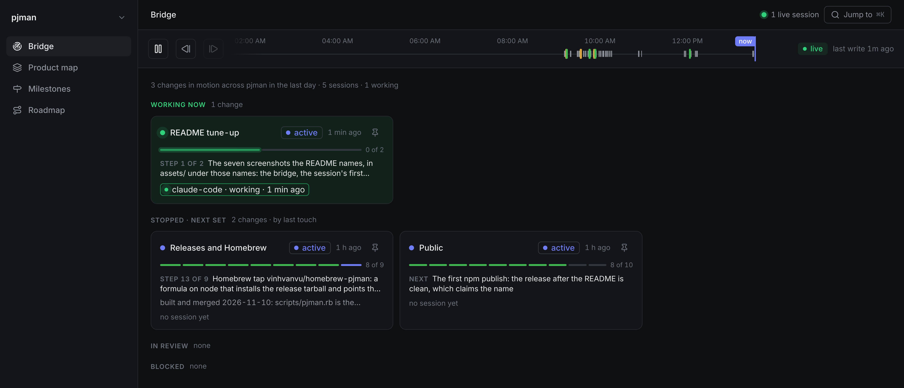
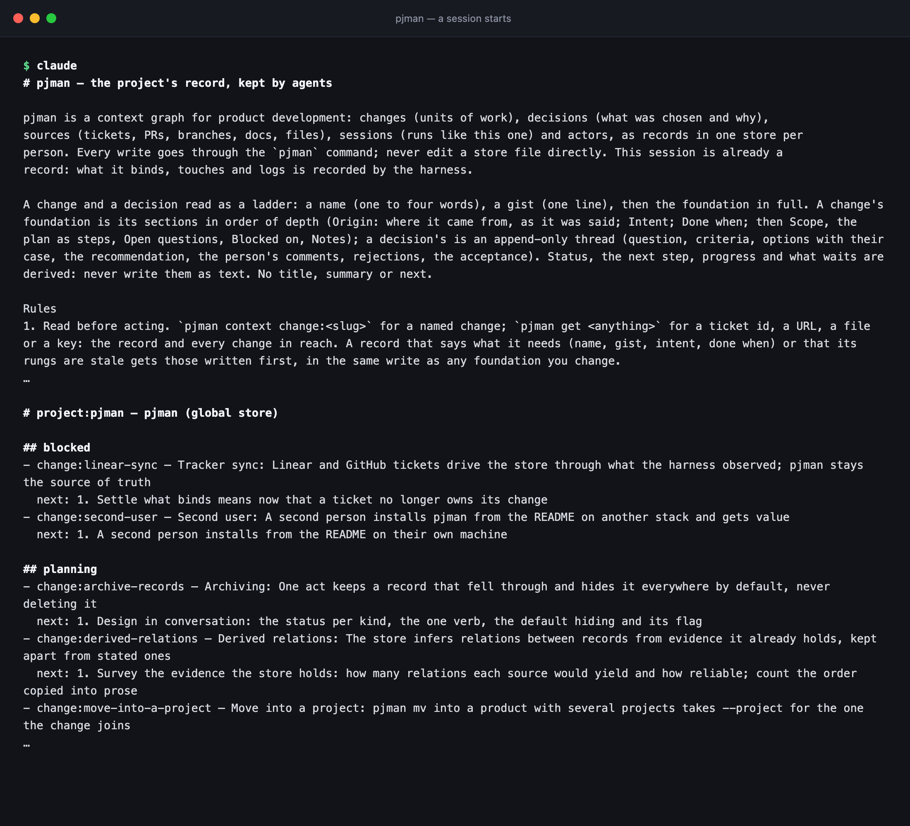
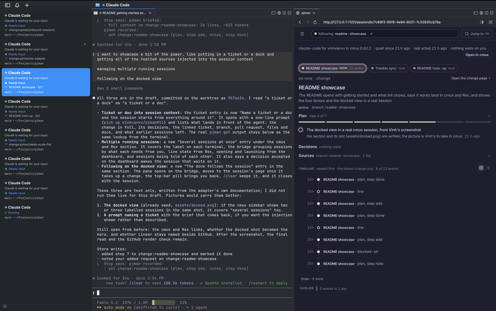
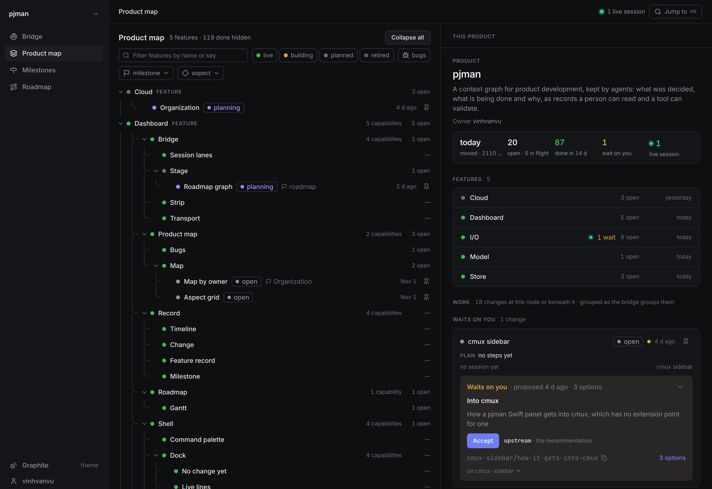
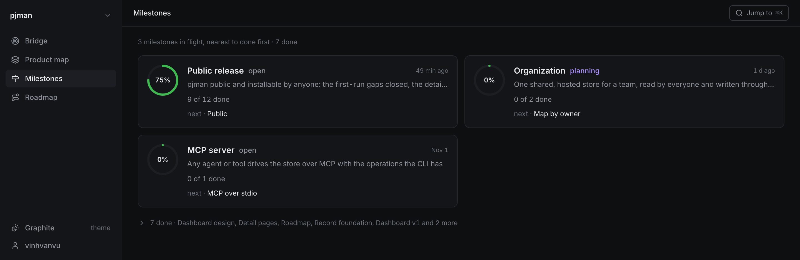
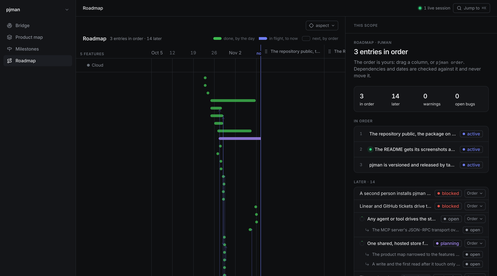
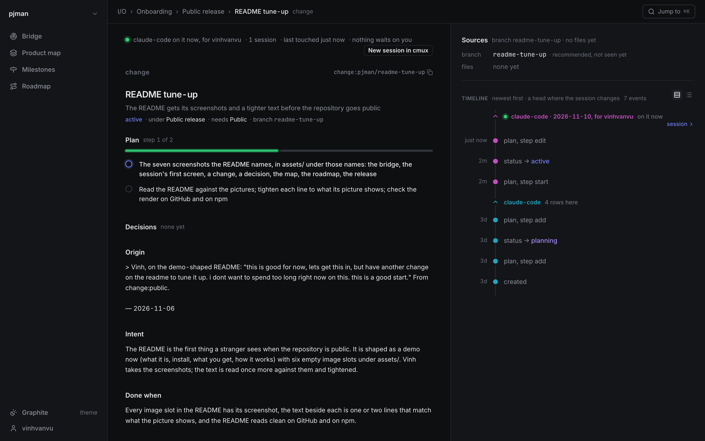
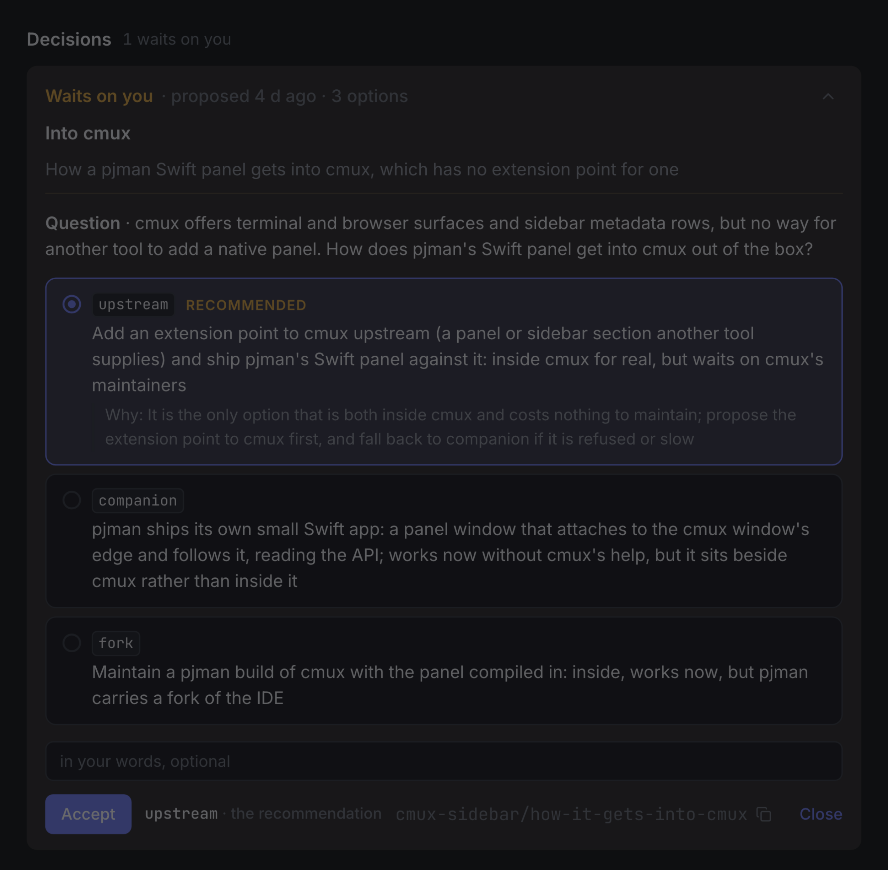
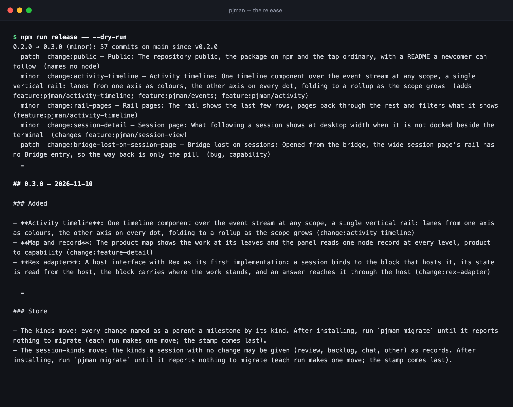

# pjman

The record of a software product, kept in git by the agents that build it.



A change, a decision, a feature, a session and a release are records in one git store, under one schema. Coding agents read the record at the start of every session and write back through one command. You read it on a dashboard and make the decisions.

> Works best in [cmux](https://cmux.com) and [Rex](https://www.superlogical.com): the dashboard docks beside the session and follows it. Any terminal works.

## Getting started

**1. Install.** Node 22.13 or newer and git; Homebrew brings its own Node. Installing with Homebrew, an npm copy that shadows it, and upgrading: [docs/install.md](docs/install.md).

```bash
npm install -g @vinhvanvu/pjman   # or: brew install vinhvanvu/pjman/pjman
```

**2. Run `pjman init` in a repository.** It asks one question, whether a product map should be proposed from the repository, and prints what it did:

```console
$ cd acme && pjman init
Should the first session propose a product map from this repository? [Y/n]
created the global store at ~/.pjman/store (its own git repository)
created person:ada
the repository holds code (package.json)
created product:acme
registered project:acme under product:acme
the first change through intake proposes a product map …
you are person:ada
Claude Code: installed the pjman plugin at user scope (hooks, skill, brief, Linear MCP); it loads at the next session or /reload-plugins
dashboard: http://127.0.0.1:7331
left to do: nothing here; to read tickets, sign in to the tracker from inside a session (/mcp)
```

When it worked you have four things: a store of your own at `~/.pjman/store`, the repository registered as a project under a product, the Claude Code plugin installed (when `claude` is on the PATH), and the dashboard running at the address it printed. Running it again is the health check: it repairs what is missing and undoes nothing.

**3. Start a session.** Run `claude` in the repository. The agent opens with what pjman is, the rules it works by, and what is in flight:



**4. Say what you want done.** The agent files it as a change with a plan, and with the first one proposes the product map as a decision for you to accept. `pjman open` brings the dashboard to the session's page; in cmux it is already docked beside you.

## Works best in cmux and Rex

pjman runs in any terminal. In [cmux](https://cmux.com) and [Rex](https://www.superlogical.com), the session and the dashboard become one workspace.



Left, every running session labelled with the change it is on and how far the plan has come. Middle, the session. Right, the dock following it: the changes it read and wrote, the one it is on now with its plan and next step, what waits on you, and its timeline.

### The dock follows the session

In cmux a pane opens beside the terminal when the session starts, on the bridge. Once the session takes up a change, the pane moves to the session's page and stays with it, live: what the session is on, the decisions waiting on you, its log lines, the handoff. Browse anywhere in the app from there; the pill in the top bar names the change and brings you back. `/clear` keeps the pane, and it closes when the session ends.

### Several sessions at once

- **Each one labelled.** The session's sidebar pill (cmux) or block (Rex) says which change it is on and where the work stands, so a row of terminals reads as a row of changes.
- **One place to see them all.** The bridge groups every live session's change by what it needs from you: working now, waiting on you, stopped with its next step set, in review, blocked.
- **Live state** (Rex). Working, waiting on you or stopped is read from the terminal itself, as it happens.
- **Open and launch from the dashboard.** A session's row brings its terminal to the front; a change can start a session in a worktree named for it.
- **Sessions know of each other.** Each is told of the other live sessions on the same change or the same part of the map. A decision you accept on the dashboard wakes the session that waits on it.

Elsewhere the dashboard opens in your browser and reads a session's state from the record. What each terminal gives is in [`adapters/hosts.md`](adapters/hosts.md).

## The dashboard

Four places, one per question.

### The bridge: what needs you now

The picture at the top. The day's writes on one timeline, every live session, and the changes in motion grouped by what each needs from you.

### The product map: what the product is



A change names the node it adds, changes or removes, and a node's state follows from the changes that built it.

### Milestones: toward what



A milestone is a goal whose plan is the changes filed under it. Its progress is their done count.

### The roadmap: in what order



Drag a column to reorder; dependencies and dates are checked against the order and never move it.

## Working with it

### Start a change by saying what you want

```text
you    export a saved card as a PDF
agent  filed change:card-export · changes feature:saved-cards · one change · later · no date
```

The agent checks for a duplicate, finds the node on the map the request alters, and files a change: where it came from in your words, what it is for, what done means, and the steps. Status and progress are derived, never written.



### Name a ticket or a doc and the session starts from everything around it

```text
you    pick up vinhvanvu/pjman#11
```

Before the agent reads a word of that prompt, pjman resolves what it names (a ticket id, an issue's URL, a doc's URL, a change) and puts the change it leads to in front of the agent in full: the origin in your words, the intent, what done means, the plan and where it stands, the decisions made and open, the ticket, branch, pull request, files and docs linked to it, and what earlier sessions left. A ticket the store has never seen is read from the tracker and filed first. The session is bound to that change, and the dock moves to it.

The same lookup from the terminal:

```console
$ pjman get vinhvanvu/pjman#11
vinhvanvu/pjman#11 → github-issue:vinhvanvu/pjman#11 (ticket id; source)
source github-issue:vinhvanvu/pjman#11 — /clear closes the cmux dock and reopens it in a new pane about 14s later

referenced by:
- binds change:clear-keeps-dock

reached change:clear-keeps-dock through binds

# change:clear-keeps-dock — Clear keeps the dock
Clearing a session keeps its docked pane and points it at the new session's page
status: done
kind: bug · severity nuisance
…
```

Issues come in from GitHub through `pjman sync`: each becomes a source in the store and, when no change has it yet, a change with the ticket in its origin.

### Decisions you make, not the agent



Before a choice that forecloses options, the agent lays the options out and recommends one. It never accepts its own. You accept on the dashboard or in the chat, in your words, and the session working the change is told.

### Releases from the record



One command reads what main shipped since the last tag, resolves each merge to its change, derives the version level, writes the changelog, publishes to npm and the Homebrew tap, and records the release.

## How it works

- The store is `~/.pjman/store`: Markdown files with YAML frontmatter, one per record, in a git repository of its own.
- The `pjman` command is the schema. Every write goes through it and is validated.
- A skill tells the agent what to record and when. Hooks do the rest: the brief, the binding, the log line, the receipt after every turn.
- The terminal a session runs in is a host (cmux, Rex), reached through one interface, so another terminal is another adapter, not another design (`adapters/hosts.md`).
- Nothing is dropped and nothing is written by hand.

## Docs

- [Reference](docs/reference.md): the store, every command by entity (create, read, list, update, delete, rename), the dashboard and the API, trackers, releases. In the terminal, `pjman help` prints the same by entity and `pjman help <entity>` one of them.
- [SCHEMA.md](SCHEMA.md): the record contract.
- [THESIS.md](THESIS.md): why.
- [The Claude Code adapter](adapters/claude-code/README.md): the hooks and the skills.

## License

Apache License 2.0. See `LICENSE` and `NOTICE`.
