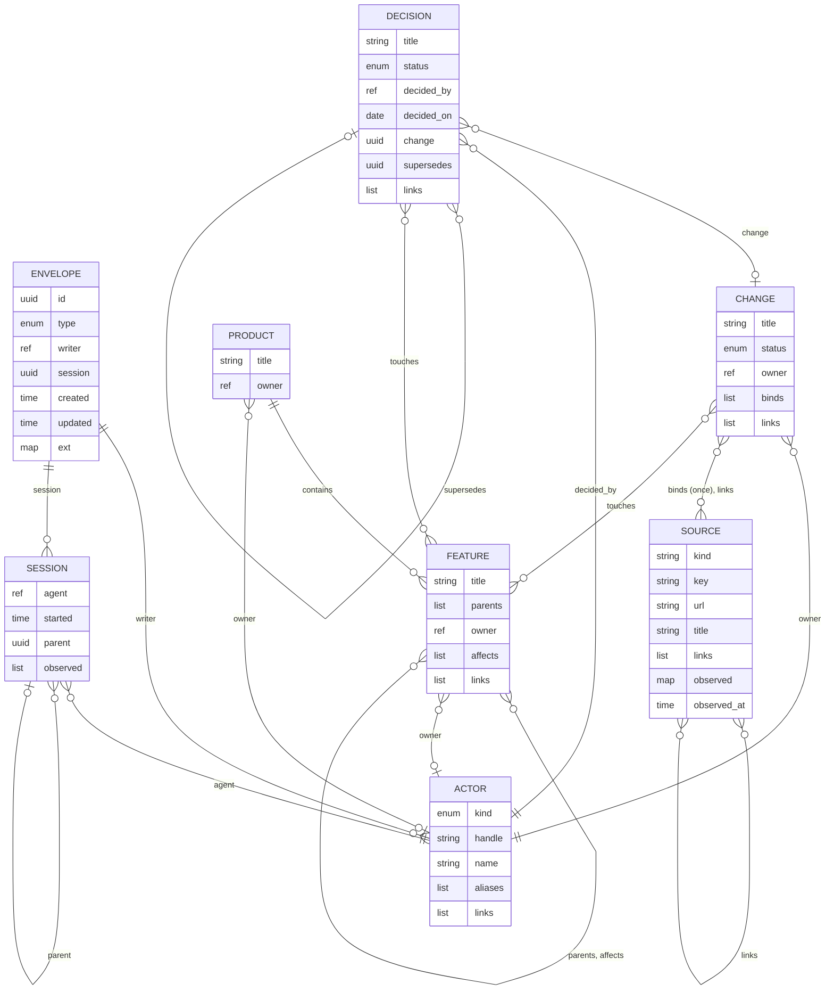

# pjman — schema (draft v2, minimal)

*2026-10-10. The record contract at its bare minimum: the structure a foundation must fix, and nothing that is content. Organised in layers; each depends only on the ones below (upper layers reference lower, never the reverse — the edge rule guarantees it). Storage-independent (thesis decision 28). **A** = authored by a actor; **D** = derived, written only by the tool that derives it. Everything not listed here is content and belongs in a record's body or under `ext:`. Draft until walked through on a real change.*

```
4 · Authority   owners with meaning, authorities, rubrics, bounded asks, maturity grades   (Phase 3 — not specified here)
3 · Product     product, feature, parents, affects, touches                                (Phase 1: present, optional)
2 · Work        change, decision, binds, the status vocabulary, drift                      (Phase 1: the product)
1 · Sources     source, session, links, observed edges                                     (Phase 1: the foundation)
0 · Core        envelope, actors, provenance, extension rule, index, validation, location
```

---

## Layer 0 · Core

### The envelope — every record

| Field | A/D | Type | Notes |
|---|---|---|---|
| `id` | D | uuid v7 | Generated at creation, immutable; what references point at |
| `type` | D | enum | `actor` · `source` · `session` · `change` · `decision` · `product` · `feature`. Self-describing when a file moves |
| `writer` | D | actor ref | The actor that created the record |
| `session` | D | session id | Optional: the run that created it. Absent on a hand-written record |
| `created`, `updated` | D | timestamp | ISO 8601 |
| `ext` | — | map | The extension namespace (below) |

Every record is a file: YAML frontmatter, Markdown body.

### Actor — `actors/<handle>.md`

An actor: a person or an agent. Created on first mention. **A actor is a definition; a session is a run; a spawn is a session, never a actor.** `agent:claude-code` is a harness; `agent:code-reviewer` is a named agent definition that recurs; a subagent spawned for one task is a session with a `parent`.

| Field | A/D | Type | Notes |
|---|---|---|---|
| `kind` | A | enum | `person` · `agent` |
| `handle` | A | string | The key: `vinh`, `claude-code`, `code-reviewer` |
| `name` | A | string | Optional display name |
| `aliases` | A | [string] | Optional former handles, so a rename orphans nothing |
| `links` | A | [source id] | Optional: a profile, an email, an agent's definition file |

**Reference form.** Actors are referenced by `person:<handle>` / `agent:<handle>`, not by id — the one deliberate exception to id-only references, so `writer: person:vinh` is readable in every file. `aliases` resolves renames.

### Provenance

**Every write has provenance.** A record knows its `writer` and `session`; a session knows its `parent` and its `agent`. In Phase 1 git provides the rest for free: `git blame` gives field-level history, and an adapter that commits records writes a `Pjman-Session: <id>` trailer on the commit. A hosted implementation must provide the same through an audit log. This is a layer-0 requirement, not a feature.

### The extension rule

Any frontmatter key the schema does not define is allowed, preserved byte-for-byte, ignored by validation, and readable through the index, under one namespace: `ext:`. Adapters and views keep their fields there (`ext.next`, `ext.branch`, `ext.cmux_workspace`, `ext.model`). Core fields can grow later without colliding. The foundation never needs to know what a sidebar wants.

### Identity

Folders are named by handle, slug or external key and may be moved or renamed; the index re-resolves by `id`. The CLI accepts a full id, a unique prefix, a slug, a handle, or a bound external key. Humans never type a UUID.

### Edges

Declared in the frontmatter of the record that made them, as lists of ids (actors by handle ref). Reverse edges are derived and never written. The set of edge types is data; each layer adds its own.

### Index

Rebuilt from the records; disposable; the only thing queries hit.

### Validation — the CLI is the schema

Frontmatter parses; required fields present; enums in range; ids well-formed; every referenced id or handle exists; derived fields match what their deriver last wrote (a hand edit to a derived field is drift); `ext:` is never validated; invalid records are reported, never silently skipped. Each layer adds rules.

### Location

A *store* is a directory holding `pjman.yaml` plus the enabled layers' folders.
- In the repository: `.pjman/` at the repository root.
- In user space: `~/.pjman/stores/<slug>/`, with `~/.pjman/config.yaml` mapping paths or repositories to stores.
- Resolution: walk up from the working directory for `.pjman/`; else the user map; else none. The same shape in either.

### Configuration — `pjman.yaml`

`layers:` enabled · `vocabulary:` the status map (layer 2) · `source_kinds:` (layer 1) · adapters. Configuration is never in a record.

---

## Layer 1 · Sources

### Source — `sources/<kind>/<key-slug>.md`

A thing outside the store: a ticket, an issue, a PR, a branch, a repo, a doc, a thread, a design, a file in the repository, another graph's node. Created on first mention. Holds what was last *observed* about it.

| Field | A/D | Type | Notes |
|---|---|---|---|
| `kind` | A | string | From `source_kinds` in configuration |
| `key` | A | string | The external identifier: `ABC-1234`, `org/repo#123`, a URL |
| `url` | A | string | Optional |
| `title` | A/D | string | Optional; authored on creation, refreshed by sync |
| `links` | A | [source id] | Optional: sources this one refers to |
| `observed` | D | map | What the external system last showed. Written only by a sync adapter |
| `observed_at` | D | timestamp | |

Filename: `key` slugified (lower-case; dots, slashes and spaces become hyphens: `THESIS.md` → `thesis-md.md`); long keys (URLs) hashed to a short stable token. The real `key` is in frontmatter.

### Session — `sessions/<yyyy-mm-dd>-<id8>.md`

A run. Derived, one writer (the adapter that produced it), append-only. Exists as the home for observed edges with provenance; everything else a run wants to record is `ext:` or body.

| Field | A/D | Type | Notes |
|---|---|---|---|
| `agent` | D | actor ref | |
| `started` | D | timestamp | |
| `parent` | D | session id | Optional: the session that spawned this one. A fan-out is a tree |
| `observed` | D | [edge] | `{edge, from, to, at}` — what this run noticed related to what |

Body: free (a log, links).

**Edges:** `links` (source → source); observed edges (session → any edge type, with provenance).
**Rules:** `(kind, key)` unique among sources; `kind` is in configuration; a session is never hand-edited — with one exception: a store's bootstrap session, written before any adapter exists, marked `ext.bootstrap: true`.

---

## Layer 2 · Work

### Change — `changes/<slug>/change.md`

A unit of work. The slug is the bound external key or a short slug; renameable.

| Field | A/D | Type | Notes |
|---|---|---|---|
| `title` | A | string | |
| `status` | A | enum | From the vocabulary |
| `owner` | A | actor ref | Optional; defaults to `writer`. Layer 4 gives it meaning |
| `binds` | A | [source id] | Optional, default empty. Identity: *this change is that ticket*. A source binds at most once |
| `links` | A | [source id] | Everything else related: docs, threads, PRs, branches. The source's `kind` says what it is |

Body: `## Summary` required (what and why). Everything else — a plan, feedback, notes — is free.

Decisions made in the course of the change live in `changes/<slug>/decisions/`.

### Decision — `changes/<slug>/decisions/<yyyy-mm-dd>-<slug>.md`, or `decisions/` at the store root

The only record a person is expected to write. Opened `proposed`; `decided` when a actor sets it.

| Field | A/D | Type | Notes |
|---|---|---|---|
| `title` | A | string | The decision in one line |
| `status` | A | enum | `proposed` · `decided` · `superseded` · `reverted` |
| `decided_by` | A | actor ref | Required when `decided` |
| `decided_on` | A | date | Required when `decided` |
| `change` | A | change id | Optional (absent for product-level decisions) |
| `supersedes` | A | decision id | Optional |
| `links` | A | [source id] | Optional |

Body: `## Decision` (what), `## Why` (rationale). Anything else is free.

### Status vocabulary — default, mapped in configuration

| Status | Meaning |
|---|---|
| `open` | Declared; nobody working on it |
| `planning` | Being shaped |
| `active` | Work underway |
| `blocked` | Waiting on something |
| `review` | Work complete, awaiting acceptance |
| `done` | Accepted |
| `dropped` | Closed without acceptance |

`vocabulary:` in `pjman.yaml` maps an organisation's words onto these (`implementing: active`, `merged: done`, a tracker's state names). Views read the canonical set.

### Drift

A bound source's `observed.status`, mapped through the vocabulary, disagreeing with the change's `status` is drift. The index reports it; nothing resolves it silently.

**Edges:** `binds` (change → source), `links` (change · decision → source), `change` (decision → change), `supersedes` (decision → decision). Session `observed` edges may have a change as `from`.
**Derived:** a change's decisions; a source's change; a change's sessions; a decision's superseded-by.
**Rules:** a source binds at most once; `status` in the vocabulary; a `decided` decision has `decided_by` and `decided_on`; a `superseded` decision is pointed at by a newer one's `supersedes`.

---

## Layer 3 · Product

Present so `touches` has a target and the tree arrives without a migration. Optional until a feature is declared.

### Product — `product.md` (one per store)

| Field | A/D | Type | Notes |
|---|---|---|---|
| `title` | A | string | |
| `owner` | A | actor ref | Optional |

### Feature — `features/<slug>/feature.md`

Not defined; only its contract is (decision 25). No `kind`, no typed hierarchy, unlimited depth.

| Field | A/D | Type | Notes |
|---|---|---|---|
| `title` | A | string | |
| `parents` | A | [feature id] | Zero or more |
| `owner` | A | actor ref | Optional; inherits along a single parent line; required with several parents |
| `affects` | A | [feature id] | Optional |
| `links` | A | [source id] | Optional |

Body: `## Summary`.

**Edges:** `touches` (change · decision → feature), `parents`, `affects` (feature → feature).
**Derived:** children; where-used; a feature's changes and decisions.
**Rules:** no cycle in `parents`; several `parents` ⇒ own `owner`; mappings to code are derived and never create features.

---

## Layer 4 · Authority — Phase 3

Not specified. What it will add, so lower layers leave room: `owner` acquires meaning (whose signature); authority records with scopes; approvers derived from `touches` and `affects`; `default` and `due` on a decision (the bounded ask); rubric records; `evidence` as a distinct edge that acceptance reads; `claim` on a feature graded against evidence; which scopes require a human as policy on the tree (decision 30).

---

## The graph, as a diagram

A view of the records and the edges between them, kept beside the tables so they change together. Every record also carries the envelope (`id`, `type`, `writer → actor`, `session → session`, `created`, `updated`, `ext`), shown once.



Layering, for the same records: layer 0 is the envelope and `ACTOR`; layer 1 is `SOURCE` and `SESSION`; layer 2 is `CHANGE` and `DECISION`; layer 3 is `PRODUCT` and `FEATURE`. Every arrow points from a higher layer to the same or a lower one.

## What was pruned from v1, and why

`next`, `goal`, `on_behalf_of`, `parent` on change, `evidence` as a field, `claim`, Plan and Feedback as contract sections, observed-edge confidence. All content, or layer 4. Each lives in a body or under `ext:` until a layer needs it as structure.

## Counts

Seven record types. Required fields beyond the envelope: actor 2, source 2, session 2, change 2, decision 2 (+2 when decided), product 1, feature 1.

## Walk-through (2026-10-10)

The store at `.pjman/` in this repository is v2 written by hand: twenty-two records. It surfaced four amendments, folded in above (sources are things outside the store, not only external; the slug rule handles dots; `binds` is optional; the bootstrap session exception), and one consequence: `DECISIONS.md` duplicates decision records and should become a view rendered from them. One vocabulary. One exception (actor refs by handle). One extension rule.
